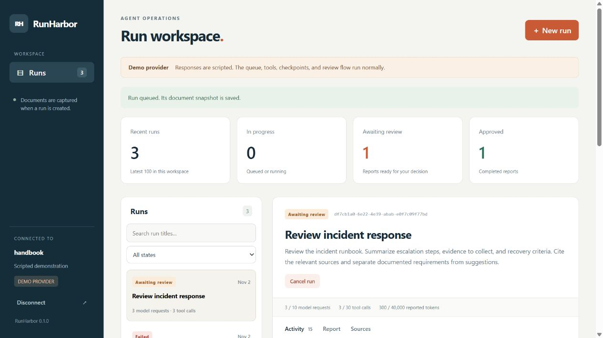
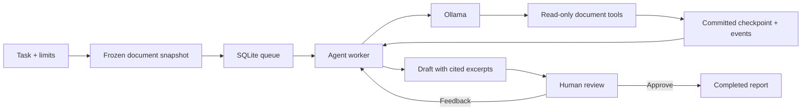

# RunHarbor

[](https://github.com/Almeida96/runharbor/actions/workflows/ci.yml)
[](https://github.com/Almeida96/runharbor/releases)

Run document agents with saved checkpoints, inspect their tool calls, and review reports against the sources they used.

RunHarbor is a Java 21 application with a local web dashboard, a SQLite job queue, and an Ollama connector. Give it a directory of runbooks or project documentation and a task such as “check the release prerequisites and rollback rules.” The agent reads a frozen copy of those documents, submits a report with source excerpts, and waits for your review. You can request a revision, approve the report, or export it as Markdown.



## What you can do

- Queue several investigations and run up to four at a time.
- Inspect every committed model request, tool result, and operator decision.
- Pause, cancel, and resume from a persisted checkpoint after an interruption.
- Keep the same source material throughout a run, even when the original files change.
- Set model-request, tool-call, and reported-token budgets for each run.
- Check cited excerpts before approving a report, or send feedback for another pass.
- Use the authenticated HTTP API from scripts as well as the dashboard.

The document tools are read-only. RunHarbor does not execute shell commands or change your source files. It is intended for one operator on one machine, not a shared hosted service.

## Try it without a model

Install a JDK 21 and set `JAVA_HOME`. From the repository root:

```sh
./gradlew test installDist
build/install/runharbor/bin/runharbor demo --out build/demo
```

PowerShell:

```powershell
.\gradlew.bat test installDist
.\build\install\runharbor\bin\runharbor.bat demo --out build/demo
```

The output directory must not exist. This command saves a checkpoint, simulates an interrupted process, changes the original document, resumes against the saved snapshot, requests a revision, and approves the result. It writes `report.md`, `run.json`, `events.json`, and a local SQLite database. Successful output includes:

```json
{"provider":"scripted-demo","state":"COMPLETED","requests":4,"tools":4,"snapshotReused":true,"checkpointResumed":true,"reviewed":true}
```

**The demo provider is scripted.** It exercises the actual queue, tools, persistence, and review workflow. It does not evaluate model quality or interpret arbitrary tasks.

## Open the dashboard

Generate an access token and start the service with the fictional handbook supplied in this repository:

```sh
export RUNHARBOR_TOKEN="$(openssl rand -hex 32)"
printf '%s\n' "$RUNHARBOR_TOKEN"
build/install/runharbor/bin/runharbor serve \
  --workspace examples/handbook \
  --db "$HOME/.runharbor/demo.db" \
  --token-env RUNHARBOR_TOKEN --provider demo
```

PowerShell:

```powershell
$bytes = New-Object byte[] 32
$rng = [System.Security.Cryptography.RandomNumberGenerator]::Create()
$rng.GetBytes($bytes)
$rng.Dispose()
$env:RUNHARBOR_TOKEN = [Convert]::ToBase64String($bytes)
$env:RUNHARBOR_TOKEN
.\build\install\runharbor\bin\runharbor.bat serve `
  --workspace examples/handbook `
  --db "$env:LOCALAPPDATA/RunHarbor/demo.db" `
  --token-env RUNHARBOR_TOKEN --provider demo
```

Open [the local dashboard](http://127.0.0.1:8790), enter that token, and select **New run**. The token stays in page memory; refreshing or disconnecting signs you out. Do not put it in a URL or commit it to a file.

The database belongs on a local disk outside a synchronized folder. Stop the process with Ctrl+C. Runs interrupted during execution require an explicit resume after restart.

## Connect Ollama

Start your Ollama service and choose an already installed model that supports native tool calling. Replace `YOUR_INSTALLED_MODEL` below with its exact name:

```sh
build/install/runharbor/bin/runharbor serve \
  --workspace ./my-handbook \
  --db "$HOME/.runharbor/workspace.db" \
  --token-env RUNHARBOR_TOKEN \
  --provider ollama --model YOUR_INSTALLED_MODEL
```

Use `runharbor.bat` on Windows. The default endpoint is `http://127.0.0.1:11434/api/chat`; `--endpoint`, `--timeout-ms`, `--parallel`, and `--port` are configurable. A model must return tool calls and usage counts. Plain text alone does not complete a run.

The connector uses Ollama's [chat API](https://docs.ollama.com/api/chat) and [tool calling](https://docs.ollama.com/capabilities/tool-calling). No cloud API key is needed for local Ollama. Model performance and hardware requirements depend on the model you install. The automated suite uses an HTTP fixture, not live model inference; a successful fixture test does not demonstrate a model's answer quality.

## How a run works



| Tool | Purpose |
| --- | --- |
| `workspace_list` | List the captured files, hashes, and line counts. |
| `workspace_search` | Find literal terms in the captured text. |
| `workspace_read` | Read a bounded line range and obtain a source ID. |
| `submit_report` | Submit a draft citing source IDs retrieved during this run. |

A cited ID proves that an excerpt was retrieved from the run's snapshot. It does **not** prove that a claim follows from that excerpt. Approval remains a human decision.

## Scope and limits

Snapshots accept UTF-8 Markdown, text, JSON, YAML, Java, Kotlin, and properties files: up to 100 files, 128 KiB per file, and 2 MiB in total. Hidden paths, common build directories, and symlinks are excluded. Search is literal term matching, not vector retrieval. PDF parsing, embeddings, external tools, and scheduled jobs are not included.

The service binds to loopback and uses a single bearer token. Every authorized client can see every run in that database. Prompts, source contents, tool results, and reports are stored locally without application-level encryption. A remote model endpoint receives the task and retrieved excerpts. Use a curated directory rather than a whole home directory or a repository containing secrets.

Completed steps are checkpointed. An in-flight model request may be issued again after an interruption; request attempts are reserved before the call. Reported tokens cover committed responses, not every potentially billable request. This is not an exactly-once runtime or a billing cap. See [execution semantics](docs/architecture.md) before integrating it into another workflow.

## Download and develop

The [release](https://github.com/Almeida96/runharbor/releases/latest) contains a ZIP with launch scripts, runtime dependencies, examples, and documentation. It requires Java 21; no Gradle installation is needed to run the extracted package. Verify the ZIP against its accompanying `SHA256SUMS` file.

```sh
./gradlew test installDist distZip
```

Tests cover snapshot boundaries, citations, transactional claims, stale responses, revision and recovery, HTTP authorization, body deadlines, and the Ollama wire contract. CI runs on Linux and Windows. Coverage reports are generated under `build/reports/jacoco/test/html/` and uploaded with the test reports.

- [Installation and operations](docs/operations.md)
- [Architecture and recovery](docs/architecture.md)
- [HTTP API](docs/api.md)
- [Contributing](CONTRIBUTING.md)
- [Changes](CHANGELOG.md)

MIT license. See [LICENSE](LICENSE).
